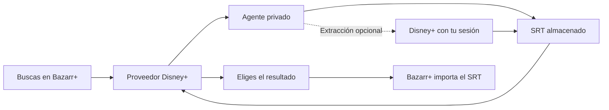

# Disney+ para Bazarr+

Busca subtítulos de episodios de Disney+ desde Bazarr+ y permite guardarlos
junto a los vídeos de tu biblioteca. Usa tu propia sesión de Disney+ mediante
un agente en Docker. **No necesitas Jellyfin ni el plugin de Moonfin.**

> **Proyecto experimental — proveedor 0.2.2.** La conexión con Bazarr+ y la
> descarga desde caché están comprobadas. El perfil migrado abre el catálogo
> de Disney+; no se ha repetido una extracción con él. Antes de importar a una biblioteca real,
> [revisa la corrección de compatibilidad HI](docs/HI-COMPATIBILITY.md).
> No es todavía una instalación de un clic ni está en el Marketplace.

La versión 0.2.2 corrige los estados de extracción. Está probada offline y
actualizada en el laboratorio con comprobaciones sintéticas. Consulta el
[plan de actualización y reversión](docs/EXTRACTION-STATES.md).

## Qué puedes hacer

- Buscar subtítulos normales en español para episodios de series Disney+.
- Reutilizar un SRT que el agente ya tenga guardado.
- Permitir, de forma opcional, que una búsqueda solicite una extracción nueva.
- Relacionar la numeración de tu biblioteca con la de Disney+.
- Elegir el resultado desde Bazarr+ para que lo importe.

Por ahora no admite películas, otros idiomas, otros servicios ni pistas
HI/SDH o forzadas. No descarga vídeo ni descifra pistas protegidas.
Tampoco garantiza que cada episodio tenga una pista accesible para tu cuenta.

## Cómo funciona

| Componente | Dónde funciona | Para qué sirve |
|---|---|---|
| **Proveedor** | En Bazarr+, instalado como ZIP en Provider Hub | Recibe búsquedas y devuelve resultados listos. |
| **Agente** | En un contenedor Docker independiente | Mantiene tu sesión de Disney+ y guarda los SRT en una caché privada. |

El agente no necesita acceso a tus vídeos ni claves de Bazarr, Sonarr o
Jellyfin. **Bazarr+ es quien escribe el SRT en la biblioteca.**

## Por dónde empezar

| Si quieres… | Lee… |
|---|---|
| Instalarlo por primera vez | [Instalación paso a paso](docs/INSTALLATION.md) |
| Configurar una serie o el mapa de episodios | [Configuración y ejemplos](docs/CONFIGURATION.md) |
| Resolver un problema de conexión o búsqueda | [Solución de problemas](docs/TROUBLESHOOTING.md) |
| Migrar desde el agente anterior | [Migración y reversión](docs/MIGRATION.md) |
| Entender el requisito HI | [Compatibilidad con Bazarr+](docs/HI-COMPATIBILITY.md) |
| Modificar código o generar el ZIP | [Desarrollo](docs/DEVELOPMENT.md) |
| Saber qué está terminado y qué falta | [Estado y próximos pasos](docs/ROADMAP.md) |

Necesitas Bazarr+ con Provider Hub, Docker con Compose, acceso a Disney+ con
tu cuenta y una biblioteca de series que Bazarr+ ya identifique. El Compose
incluido instala el agente; no instala Bazarr+. El entorno probado es Docker
en Linux x86_64, controlado desde Windows. Otras plataformas no están verificadas.

## Primera búsqueda: qué esperar

1. Inicias sesión en Disney+ desde el navegador del agente.
2. Configuras el token privado y el mapa de la serie en el proveedor.
3. Mantienes apagadas las búsquedas programadas de Bazarr+.
4. Buscas manualmente un episodio sin subtítulos en español.
5. Si el SRT está guardado, aparece inmediatamente. Si no, solo se solicita
   una extracción cuando activas `enable_requests`.
6. El proveedor puede esperar hasta 75 segundos por defecto. Si el agente
   necesita más tiempo, vuelve a buscar después.

**Con `enable_requests=false`, una caché vacía da una búsqueda sin resultados.**
Es el comportamiento inicial esperado. El proveedor no sabe si el episodio
ya tiene español: selecciona los episodios sin subtítulos en Bazarr+.

## Preguntas frecuentes

**¿Por qué aparecen nombres como `moonfinbridge`?**

Es el identificador interno original. Se conserva para actualizar las
instalaciones existentes y mantener la compatibilidad HI. No implica una
dependencia de Jellyfin.

**¿Funciona con Bazarr oficial?**

Este paquete utiliza el Provider Hub de **Bazarr+**. No se instala como
proveedor en Bazarr oficial mediante este procedimiento.

**¿Dónde consigo el ZIP?**

En los artefactos de una ejecución satisfactoria de
[GitHub Actions](https://github.com/metoocrib-lang/bazarr-plus-disneyplus/actions/workflows/check.yml),
o generándolo con los comandos de instalación. Dentro de la descarga de
Actions está `disneyplus-provider.zip`, el archivo que debes cargar en Provider
Hub. Los artefactos duran 30 días y no equivalen a una release estable.

**¿Dónde introduzco mi contraseña de Disney+?**

Solo en Disney+, dentro del navegador del agente. El token del proveedor y
la contraseña de noVNC son credenciales distintas, creadas localmente.

**¿Activa sincronización o búsquedas automáticas?**

No las activa por sí mismo. La sincronización depende de tu archivo de vídeo;
no es necesaria para consultar la caché ni para instalar el proveedor.

## Estado comprobado

Se verificaron el arranque del agente, su autenticación, Chromium, noVNC, una
descarga sintética y la migración de 17 SRT con integridad comprobada. El
proveedor 0.2.1 se probó mediante la búsqueda de Bazarr+ y su worker real.
La extracción real se había probado en el agente anterior; aún no se ha
repetido con la sesión migrada del agente independiente.

Los resultados están en [Verificación](docs/VERIFICATION.md) y
[Migración](docs/MIGRATION.md). El código procede de
[Jellyfin.Plugin.SubtitleBridge](https://github.com/metoocrib-lang/Jellyfin.Plugin.SubtitleBridge),
pero esta integración funciona de forma independiente.
